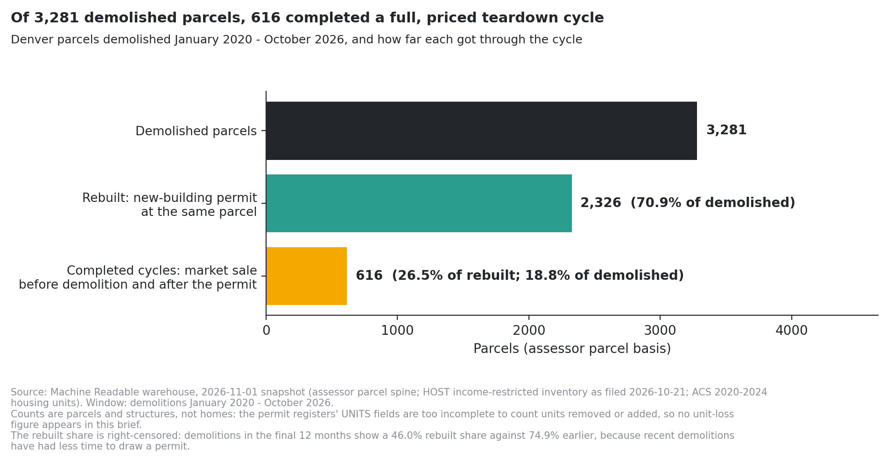
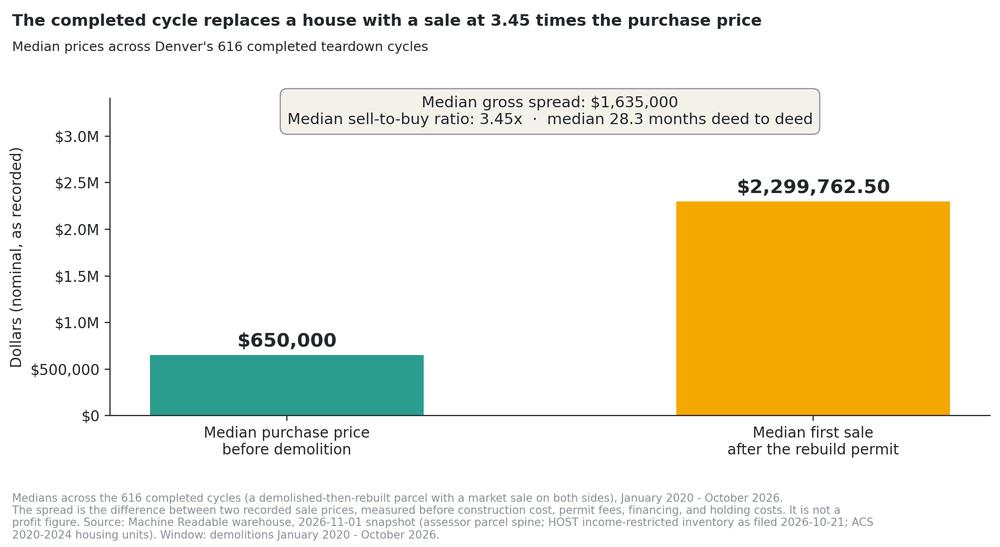
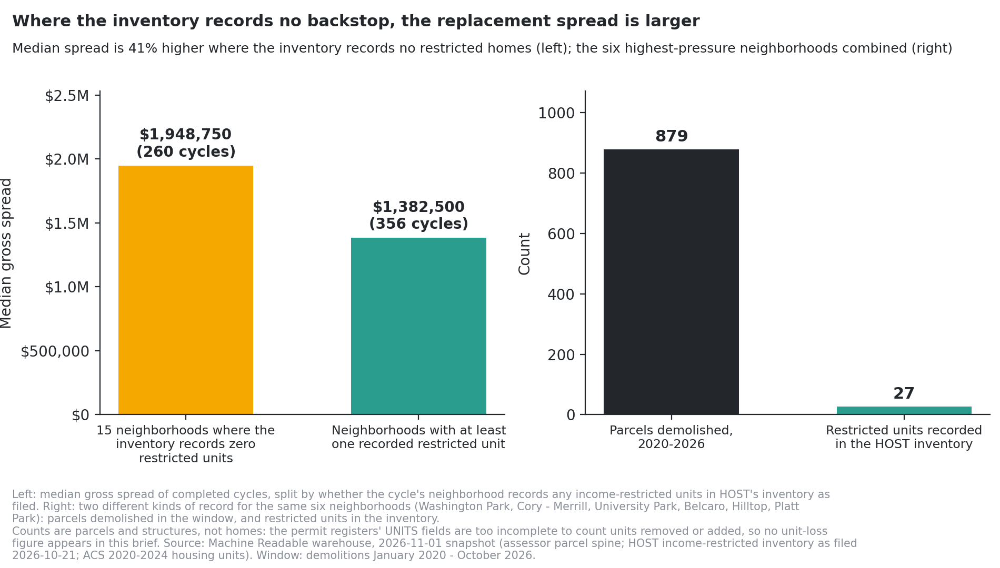
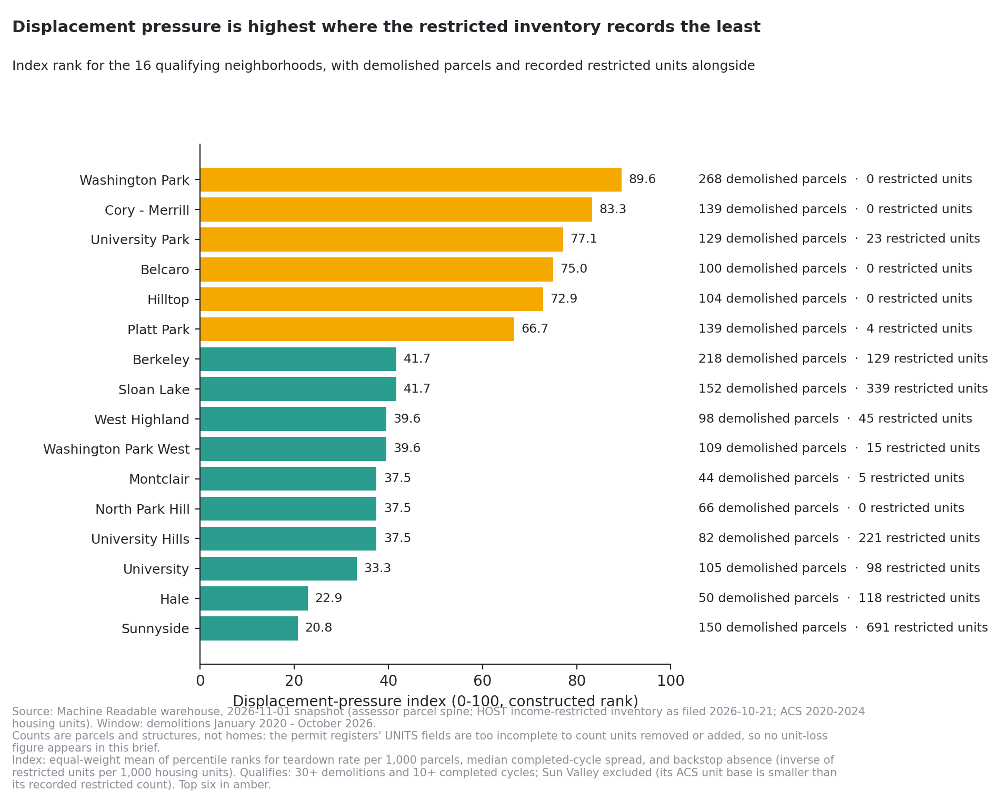

# Four of Every Ten Completed Denver Teardown Cycles Closed in a Neighborhood With No Income-Restricted Homes

In Washington Park, the pattern is stark: 268 parcels were demolished between January 2020 and October 2026, and the Department of Housing Stability (HOST) inventory of income-restricted homes records no restricted home there.

This brief joins four analyses published earlier in this series (the assessor sales keystone, permits and demolitions, the housing permits brief, and the HOST affordable housing inventory) on the parcel and neighborhood keys they share. Citywide, on the parcel basis—counting each assessor parcel once rather than counting permits—3,281 parcels were demolished in the window, 2,326 of them (70.9 percent) drew a new-building permit at the same parcel, and 616 parcels completed a full cycle. A completed cycle is a parcel with a market purchase before demolition, a new-building permit, and a market sale after that permit. Across those 616 cycles, the median purchase price before demolition was $650,000, the median first sale after the rebuild permit was about $2.30 million, and the median gross spread between the two recorded prices was $1,635,000, over a median of 28.3 months deed to deed. The spread is a difference between two recorded sale prices: it is measured before construction cost, permit fees, financing, and holding costs, and it is not a profit figure. This brief counts structures and prices, not homes: the permit registers' UNITS fields are too incomplete to count units removed or added (Finding 5 and Data notes), so no unit-loss figure appears anywhere in it.

*The teardown cycle, parcel basis. Counts are parcels and structures, not homes; for recent demolitions, the rebuilt share is right-censored, meaning those parcels have had less time to draw a permit (Finding 1).*

## Finding 1: The completed cycle replaces a house with a sale at 3.45 times the purchase price

Across the 616 completed cycles, the median ratio of first post-rebuild sale price to pre-demolition purchase price is 3.45 (derived). The cycle is fast at the front end: in the 2026-10-16 keystone analysis—which measured how soon before demolition the earlier purchase closed—91.2 percent of paired purchases on the earlier snapshot closed within 36 months before the demolition.

*Median prices across the 616 completed cycles.*

*Censoring note:* The rebuilt share is right-censored and the brief does not rank neighborhoods by it: demolitions in the final 12 months of the window show a rebuilt share of 46.0 percent, against 74.9 percent for demolitions earlier in the window, because recent demolitions have had less time to draw a permit.

## Finding 2: The 15 neighborhoods with no recorded restricted homes hold 23.1 percent of demolitions and 42.2 percent of completed cycles

In this brief, “backstop” means the income-restricted stock recorded in “the inventory as filed” (HOST's published inventory, taken exactly as recorded). HOST's inventory records zero income-restricted units in 15 of Denver's 78 statistical neighborhoods (the 2026-10-21 brief lists them). Those 15 neighborhoods hold 758 of the 3,281 demolished parcels (23.1 percent, derived) and 260 of the 616 completed cycles (42.2 percent, derived). The median gross spread of the cycles in zero-restricted neighborhoods is $1,948,750, against $1,382,500 in neighborhoods with at least one recorded restricted unit: about 41 percent higher (derived). Across the 29 neighborhoods with at least 30 demolitions, the teardown rate per 1,000 parcels and the restricted-units rate per 1,000 housing units move in opposite directions (Spearman correlation -0.35, derived): neighborhoods with more demolition per parcel tend to record less restricted housing per unit, with wide scatter around that tendency.

*Left: median gross spread by whether the cycle's neighborhood records any restricted units. Right: two different kinds of record for the same six neighborhoods (demolished parcels; restricted units in the inventory). Counts are parcels and structures, not homes.*

## Finding 3: A displacement-pressure index puts six neighborhoods at the top; four of the six record no restricted homes

The index averages equal-weight percentile ranks for three components: teardown rate (demolished parcels per 1,000 parcels), median completed-cycle spread (the replacement jump), and backstop absence (the inverse of restricted units per 1,000 housing units). A neighborhood qualifies with at least 30 demolitions and at least 10 completed cycles; 16 of 78 neighborhoods qualify, and they hold 1,953 of the 3,281 demolished parcels (59.5 percent, derived). Sun Valley is excluded for the base mismatch printed in the 2026-10-21 brief: its ACS housing-unit base (502.9 units) is smaller than its recorded restricted count (1,196 units), so its rate cannot be ranked; on the parcel basis it records 11 demolished parcels and no rebuilds in the window.

The six highest-ranked neighborhoods are Washington Park (index 89.6), Cory - Merrill (83.3), University Park (77.1), Belcaro (75.0), Hilltop (72.9), and Platt Park (66.7). Together they account for 879 demolished parcels (26.8 percent of the citywide total, derived) and 311 completed cycles (50.5 percent of all cycles, derived), and the HOST inventory records 27 restricted units across all six combined: Washington Park, Cory - Merrill, Belcaro, and Hilltop record zero; Platt Park records 4 and University Park 23. The index is not a demolition-count ranking: Sunnyside, with 150 demolitions (the fourth-highest count), ranks last of the 16 because its restricted rate (129.7 per 1,000 units) is the highest in the ranked set and its median spread ($710,750) is the lowest. Washington Park's denominator is 3,572 parcels, so the demolitions amount to one parcel in 13 (derived); its 87 completed cycles have a median purchase price of $1,000,000 and a median first sale after the rebuild of $3,100,000.

*The index is a constructed ranking (equal-weight percentile ranks of teardown rate, median spread, and backstop absence), not a measurement; its components are in the table below and in data/neighborhood_index.csv.*

The chart carries the ranking; the table below is the full record for the qualifying neighborhoods.

| Neighborhood | Demolished parcels | Per 1,000 parcels | Completed cycles | Median buy | Median first sale after rebuild | Median spread | Restricted units | Restricted per 1,000 units | Index |
|---|---|---|---|---|---|---|---|---|---|
| Washington Park | 268 | 75.0 | 87 | $1,000,000 | $3,100,000 | $2,140,000 | 0 | 0.0 | 89.6 |
| Cory - Merrill | 139 | 71.4 | 73 | $635,000 | $2,435,000 | $1,810,000 | 0 | 0.0 | 83.3 |
| University Park | 129 | 51.5 | 50 | $785,000 | $3,125,000 | $2,432,250 | 23 | 4.8 | 77.1 |
| Belcaro | 100 | 40.6 | 38 | $835,000 | $2,845,000 | $2,010,235 | 0 | 0.0 | 75.0 |
| Hilltop | 104 | 34.3 | 34 | $902,500 | $3,132,500 | $2,295,787.50 | 0 | 0.0 | 72.9 |
| Platt Park | 139 | 47.0 | 29 | $650,000 | $2,199,000 | $1,550,000 | 4 | 1.1 | 66.7 |
| Berkeley | 218 | 50.2 | 47 | $525,000 | $1,610,000 | $1,163,250 | 129 | 26.9 | 41.7 |
| Sloan Lake | 152 | 46.9 | 37 | $630,000 | $2,115,000 | $1,470,000 | 339 | 78.7 | 41.7 |
| West Highland | 98 | 24.9 | 19 | $650,000 | $2,100,000 | $1,495,000 | 45 | 7.8 | 39.6 |
| Washington Park West | 109 | 34.9 | 12 | $633,250 | $1,632,743.50 | $1,144,493 | 15 | 3.5 | 39.6 |
| Montclair | 44 | 16.0 | 15 | $460,000 | $1,995,000 | $1,425,000 | 5 | 1.6 | 37.5 |
| North Park Hill | 66 | 16.1 | 12 | $512,500 | $1,276,250 | $796,250 | 0 | 0.0 | 37.5 |
| University Hills | 82 | 29.0 | 23 | $431,000 | $2,100,000 | $1,645,000 | 221 | 63.6 | 37.5 |
| University | 105 | 31.0 | 35 | $529,900 | $1,862,500 | $1,345,000 | 98 | 25.7 | 33.3 |
| Hale | 50 | 15.1 | 10 | $630,000 | $1,800,000 | $1,177,500 | 118 | 22.0 | 22.9 |
| Sunnyside | 150 | 37.2 | 14 | $576,195 | $1,140,000 | $710,750 | 691 | 129.7 | 20.8 |

Full panel for all 78 neighborhoods, with the three component scores for every ranked neighborhood: data/neighborhood_index.csv in this package.

## Finding 4: The median demolished home with a recorded purchase last sold for $711,000; about one in five sold at or under $500,000

A pre-demolition market purchase is observable for 1,913 of the 3,281 demolished parcels (the rest were last transferred outside the sales table's 2015 start, by a non-market instrument, or not at all in the record). The median such purchase was $711,000, and 421 of the 1,913 (22.0 percent, derived) were at or under $500,000. For scale, the keystone brief's citywide price mix—the share of all Denver market sales at or under $500,000—fell from 57.2 percent in 2020 to 47.4 percent in 2025. The lowest-priced removed stock sits in neighborhoods where few cycles complete: in Overland, the median observable purchase of a demolished parcel was $459,000 and 10 of 15 observable purchases were at or under $500,000; in Villa Park the median was $445,000 and 8 of 10 were at or under $500,000. Berkeley, which recorded the second-most demolitions (218), sits between the two patterns: 122 observable purchases at a median of $570,000, 32.0 percent of them at or under $500,000, and 47 completed cycles at a median buy of $525,000.

## Finding 5: In 13 neighborhoods with heavy demolition, the sales record cannot yet price the replacement

Thirteen neighborhoods recorded at least 30 demolitions but fewer than 10 completed cycles, so they are not ranked: Baker, Cherry Creek, Cole, Congress Park, Country Club, Five Points, Highland, Overland, Rosedale, South Park Hill, Speer, Villa Park, and West Colfax. In those 13 neighborhoods, 497 parcels were demolished and rebuilt, and 47 completed a paired cycle. Of their rebuilt parcels—using those rebuilt parcels, not all demolished parcels, as the base—41.9 percent carry a pre-demolition market purchase on the same parcel and 41.6 percent carry a post-permit sale; against all rebuilt parcels citywide, the corresponding figures are 61.2 and 43.8 percent. A rebuild that is held as a rental, or built on a parcel assembled or split in the project, does not produce a paired cycle on the original parcel, so this brief's cycle lens measures the single-structure teardown market and understates redevelopment that takes other forms. West Colfax is the largest case: 119 demolished parcels, 72 rebuilt, 5 completed cycles, and 1,621 recorded restricted units (225.6 per 1,000 housing units), the fourth-largest restricted stock of any neighborhood. Separately, unit counts cannot repair this gap from the permit side: the UNITS field is filled in on 55.9 percent of new-building permits and 41.4 percent of demolition permits in the window (positive values on 55.6 and 40.5 percent), so neither units removed nor units added can be totaled from the registers as published.

## What this might mean

One reading is that market-rate replacement and the restricted inventory are arranged inversely: the neighborhoods where teardowns convert the most value per parcel are, in the main, neighborhoods the restricted inventory does not reach, so nothing in the subsidized stock offsets the repricing where it is largest, while the neighborhoods losing the lowest-priced structures (Finding 4) are the ones where the replacement outcome is not yet visible in the sales record. The strongest alternative explanation is a common cause rather than an interaction: teardown economics follow land values, and restricted projects were sited over five decades where land, zoning capacity, and program rules allowed, so both patterns may be downstream of the same land-price map without either one influencing the other. The data in this package can show the current arrangement and its size; it cannot by itself separate those two accounts, and it does not measure whether any household was displaced.

## Data notes and limits

- Snapshot: this analysis runs on the Machine Readable warehouse's 2026-11-01 re-snapshot of the same city services the October briefs used at 2026-10-15, over the same window (demolitions from 2020-01-01 to 2026-10-12). Citywide figures moved by recordings posted between snapshots: demolished parcels 3,297 to 3,281, rebuilt 2,335 to 2,326, completed cycles 611 to 616, median spread unchanged at $1,635,000. The full reconciliation is in verification.md. Figures here are on the 2026-11-01 snapshot throughout and are not mixed with the October figures.
- Bases: demolition, rebuild, and cycle counts are parcel-basis (assessor parcel spine). The permit-register basis counts permits, not parcels (11,585 new-building permits and 3,836 demolition permits in the window), and the two bases are never combined in one figure. As a control, neighborhood demolition counts on the two bases correlate at Spearman 0.974, and the top three neighborhoods are the same on both.
- What a completed cycle is: a demolished-then-rebuilt parcel with a market sale strictly before the demolition date and a market sale strictly after the first new-building permit date, on the same parcel. Of rebuilt parcels, 61.2 percent have the purchase side and 43.8 percent have the sale side; the 616 cycles are the intersection, and their medians describe completed, resold rebuilds, not all rebuilds. Among rebuilt parcels, 0 market sales fall on the demolition date, 1 falls on the permit date, and 76 fall between demolition and permit and are excluded by the strict ordering.
- Same-day deed clusters: 56 demolished parcels carry more than one market sale on their last pre-demolition date, at differing prices on 51 of them. This package applies one printed rule (nominal prices at or under $100 never win a tie against a real price; then the last-recorded deed wins on the purchase side and the first-recorded on the sale side). The rule and its counts are documented in verification.md.
- Purchases are observable only from 2015 (the sales table's first year) and only when the purchase was itself a market sale (warranty or special warranty deed with a stated price). Removed-stock medians in Finding 4 describe the 58.3 percent of demolished parcels with an observable purchase.
- Backstop means the HOST inventory as filed on 2026-10-21. Dispersed and scattered-site portfolios are booked to a single neighborhood in that inventory (the 2026-10-21 brief documents this), so a neighborhood recording zero may contain individual restricted homes the inventory books elsewhere. Restricted rates divide 2026 inventory units by ACS 2020-2024 housing units; the two sources have different vintages.
- Prices are nominal dollars as recorded. The gross spread is not net of construction, fees, financing, or time, and no figure in this brief measures profit, displacement of occupants, or the number of homes on any parcel. No source used here records whether a demolished structure was occupied.

## Who can act

- Who: the Department of Housing Stability (HOST), which is preparing a housing needs assessment due in December 2026 to feed its next strategic plan, to be presented to City Council by September 1, 2027; and Community Planning and Development (CPD), which administers the demolition and building permit registers and the Blueprint Denver growth framework.
- Action: HOST can carry a teardown-and-replacement table, in the form of Finding 3's panel, into the needs assessment, so the assessment records where market-rate replacement is repricing neighborhoods with no restricted stock (a staff analysis task; low-cost operational change). CPD can make the UNITS field required on demolition and new-building permits, which is the single change that would let the city count homes removed and added rather than structures (low-cost operational change, a permit-application rule). Council's Safety, Housing, Education and Homelessness Committee, which oversees HOST, can ask for both in the plan process (oversight action). For context from this series: the 2026-10-11 brief's permit-geography measure found 74.6 percent of new buildings permitted since 2020 went up outside Blueprint Denver's designated growth areas, so the plan's geography and the teardown geography can be compared on the same neighborhood panel.
- How we would know it worked: the next HOST inventory pull would show changed restricted counts in the six neighborhoods named in Finding 3, measured in this same dataset; the next permit-register pull would show UNITS completeness rising from 55.9 and 41.4 percent toward completeness; and a repeat of this join on the next warehouse snapshot would show whether the zero-restricted share of completed cycles (42.2 percent) is moving.

## Methods

Definitions replicate the 2026-10-16 keystone package (market sale, lifecycle ordering, window) and are recorded with the full methods checklist, the pre-flight audit output, the snapshot reconciliation, and the independent verification ledger in this package: sources.md, verification.md, data/audit_output.txt, data/verification_ledger.csv. Analysis code: code/analyze.py; independent verifier: code/verify_independent.py. Every figure in this brief cross-checks against stats.json.
